<!--
  Profile README for github.com/Samiullah-2004
  Every animated card in assets/svg is generated by scripts/build.mjs from scripts/content.mjs.
-->

<a href="https://samiullah-portfolio-orpin.vercel.app/">
  
</a>

<p align="center">
  <a href="mailto:samiullah.akram.3009@gmail.com"></a>&nbsp;
  <a href="https://www.linkedin.com/in/samiullah-akram-a28461404/"></a>&nbsp;
  <a href="https://www.upwork.com/freelancers/~01ffa5cf678d8eff63"></a>&nbsp;
  <a href="https://samiullah-portfolio-orpin.vercel.app/"></a>
</p>

<p align="center">
  
</p>

<p align="center">
  <a href="#about"><b>About</b></a> &nbsp;·&nbsp;
  <a href="#stack"><b>Stack</b></a> &nbsp;·&nbsp;
  <a href="#projects"><b>Projects</b></a> &nbsp;·&nbsp;
  <a href="#education"><b>Education</b></a> &nbsp;·&nbsp;
  <a href="#activity"><b>Activity</b></a> &nbsp;·&nbsp;
  <a href="#contact"><b>Contact</b></a>
</p>

<br />

<a name="about"></a>

<picture>
  <source media="(prefers-color-scheme: dark)" srcset="./assets/svg/headings/about-dark.svg" />
  
</picture>

### I design, build and ship end-to-end products, from AI-powered SaaS and real-time systems to secure payments and fast, responsive interfaces.

I'm a Full-Stack Developer working across **React, Next.js, TypeScript, Node.js and PostgreSQL**. I care about the whole product: the design system, the API, the database, the payments, the tests and the deployment.

Right now I'm at **JayTech Elite Firm**, where I designed and built most of **SmokeScreen V2**, a live AI video streaming SaaS: its UI, backend, payment integration, admin tools, testing and deployment on Railway and Hostinger. I also fix production issues on the live V1.

Before that I completed web development internships at **Qwetrum Technologies** and **Decode Labs**. I'm studying for a BSCS at Alhamra University (NCBA&E) and take on freelance projects through [Upwork](https://www.upwork.com/freelancers/~01ffa5cf678d8eff63).

📍 Lahore, Pakistan &nbsp;·&nbsp; 💼 Full-Stack Developer at JayTech Elite Firm &nbsp;·&nbsp; 🎓 BSCS, Alhamra University &nbsp;·&nbsp; 🌍 Open to remote roles worldwide


```javascript
const samiullah = {
  role: "Full-Stack Developer",
  location: "Lahore, Pakistan 🇵🇰",
  now: "Building SmokeScreen V2, a live AI video SaaS, @ JayTech Elite Firm",

  experience: [
    "Full-Stack Developer @ JayTech Elite Firm (Sept 2026 – Present)",
    "Web Development Intern @ Decode Labs (July 2026)",
    "Web Development Intern @ Qwetrum Technologies (June 2026)",
  ],
  education: "BSCS @ Alhamra University (NCBA&E) · 2024 – 2028 · CGPA 3.67 / 4.0",

  coreStack: {
    languages: ["JavaScript", "TypeScript", "SQL"],
    frontend:  ["React.js", "Next.js", "Redux", "Tailwind CSS", "Vite", "React Hook Form", "React Router"],
    backend:   ["Node.js", "Express.js", "REST APIs", "GraphQL", "Apollo Server", "Zod", "Multer", "Webhooks"],
    auth:      ["JWT", "OAuth", "NextAuth", "bcrypt", "Row Level Security"],
    realtime:  ["Socket.IO", "WebRTC", "WebSockets"],
    databases: ["PostgreSQL", "Prisma ORM", "pgvector", "Supabase", "MongoDB", "Mongoose", "DynamoDB",
                "MySQL", "SQLite"],
    ai:        ["Groq (Llama 3.3)", "Google Gemini", "Hugging Face Embeddings", "Claude", "OpenRouter",
                "fal.ai", "MiniMax", "RAG Pipelines"],
    payments:  ["Stripe", "Flutterwave", "Squad"],
    motion:    ["GSAP", "Framer Motion", "Lenis"],
    testing:   ["Jest", "Vitest", "Supertest", "Playwright"],
    devops:    ["Docker", "Kubernetes", "AWS (EC2 · ECS · ECR)", "GitHub Actions", "Nginx"],
    deploy:    ["Vercel", "Railway", "Render", "Hostinger", "Supabase"],
    tools:     ["Git", "GitHub", "VS Code", "Postman", "Cloudinary", "AWS SDK"],
  },

  openSource: "First external contributor to get a PR merged into klorn",
  currentlyLearning: ["Agentic AI (LangChain / LangGraph, MCP)", "Python for AI/ML tooling",
                      "Advanced RAG architectures"],
  openTo: "Remote full-stack roles & freelance projects",
};
```

<br />

<a name="stack"></a>

<picture>
  <source media="(prefers-color-scheme: dark)" srcset="./assets/svg/headings/stack-dark.svg" />
  
</picture>

<p align="center">
  
  
</p>
<p align="center">
  
</p>
<p align="center">
  
</p>
<p align="center">
  
</p>
<p align="center">
  
</p>
<p align="center">
  
</p>
<p align="center">
  
  
</p>
<p align="center">
  
</p>
<p align="center">
  
  
</p>
<p align="center">
  
</p>

<br />

<a name="projects"></a>

<picture>
  <source media="(prefers-color-scheme: dark)" srcset="./assets/svg/headings/projects-dark.svg" />
  
</picture>

<a href="https://smokescreenapp.com/">
  
</a>

A creator turns on their webcam, picks a scene, and an AI model transforms how they look and where they are, live. I designed the V2 rebuild and built most of it: the design system and 35+ pages, the Express + Supabase backend, card payments and per-second credit billing, AI creative tools, the admin panel, tests and deployment.

[**Live site (V1) ↗︎**](https://smokescreenapp.com/) &nbsp;·&nbsp; [**My role at JayTech**](#experience)

<table>
  <tr>
    <td width="50%" valign="top">
      <a href="https://chatspark-ai-9hwh.vercel.app/"></a>
      <p>Upload documents, train a chatbot on them and embed it anywhere with one script tag. A full RAG pipeline built from scratch: PDF chunking, Hugging Face embeddings, pgvector search and Groq (Llama 3.3) answers, with multi-tenant isolation.</p>
      <p><a href="https://chatspark-ai-9hwh.vercel.app/"><b>Live ↗︎</b></a> &nbsp;·&nbsp; <a href="https://github.com/Samiullah-2004/Chatspark-ai"><b>Code ↗︎</b></a></p>
    </td>
    <td width="50%" valign="top">
      <a href="https://github.com/Samiullah-2004/codemeet-ai"></a>
      <p>Live technical interviews in one room: peer-to-peer WebRTC video, a synced Monaco editor, chat and Gemini code review. Socket.IO signaling on AWS EC2, DynamoDB sessions, and client-side call recording with zero storage cost.</p>
      <p><a href="https://github.com/Samiullah-2004/codemeet-ai"><b>Code ↗︎</b></a></p>
    </td>
  </tr>
  <tr>
    <td width="50%" valign="top">
      <a href="https://comptoir-food.vercel.app/"></a>
      <p>Browse a live GraphQL menu, pay with Stripe and track the order over Socket.IO. Admin analytics with Recharts, a RAG concierge powered by ChatSpark, Docker + Kubernetes, Vitest / Supertest / Playwright, and CI/CD across 50 pull requests.</p>
      <p><a href="https://comptoir-food.vercel.app/"><b>Live ↗︎</b></a> &nbsp;·&nbsp; <a href="https://github.com/Samiullah-2004/Comptoir"><b>Code ↗︎</b></a></p>
    </td>
    <td width="50%" valign="top">
      <a href="https://resumeforge-puce.vercel.app/"></a>
      <p>Paste a job description and ResumeForge rewrites your resume to match it with live Groq (Llama 3.3) inference. Next.js and TypeScript end to end, with JWT auth and a saved history of every tailored resume.</p>
      <p><a href="https://resumeforge-puce.vercel.app/"><b>Live ↗︎</b></a> &nbsp;·&nbsp; <a href="https://github.com/Samiullah-2004/ResumeForge"><b>Code ↗︎</b></a></p>
    </td>
  </tr>
  <tr>
    <td width="50%" valign="top">
      <a href="https://bill-mate-three.vercel.app/"></a>
      <p>Invoicing for freelancers: client management, automatic invoice numbers, payment status tracking and a live earnings dashboard, on an Express + TypeScript MVC API with Prisma and isolated multi-user data.</p>
      <p><a href="https://bill-mate-three.vercel.app/"><b>Live ↗︎</b></a> &nbsp;·&nbsp; <a href="https://github.com/Samiullah-2004/BillMate"><b>Code ↗︎</b></a></p>
    </td>
    <td width="50%" valign="top">
      <a href="https://github.com/Samiullah-2004/Stowe"></a>
      <p>A complete e-commerce store on Node.js, Express and MongoDB: product listings with Multer image uploads, bcrypt + JWT auth, cart, orders and an owner dashboard for inventory.</p>
      <p><a href="https://github.com/Samiullah-2004/Stowe"><b>Code ↗︎</b></a></p>
    </td>
  </tr>
</table>

<details>
<summary><b>More projects</b></summary>
<br />

| Project | What it is | Built with | Links |
| :-- | :-- | :-- | :-- |
| **OnyxChess** | Real-time multiplayer chess with turn enforcement and a board that flips per player | Node.js · Socket.IO · chess.js | [Code](https://github.com/Samiullah-2004/OnyxChess) |
| **LivePin** | Live multi-user location tracking on an interactive map | Node.js · Socket.IO · Leaflet.js | [Code](https://github.com/Samiullah-2004/LivePin) |
| **Movie Browser** | Movie discovery app, my Qwetrum internship capstone | React · TMDB API · Tailwind CSS | [Live](https://movie-browser-khaki-seven.vercel.app/) · [Code](https://github.com/Samiullah-2004/Movie-Browser) |
| **Paste App** | Snippet manager with a single Redux store, live word counts and search | React · Redux Toolkit · React Router | [Live](https://paste-app-pied-iota.vercel.app/) · [Code](https://github.com/Samiullah-2004/Paste-App) |
| **Crypto Tracker** | Live prices, market caps and 24h changes for the top 10 coins | JavaScript · CoinGecko API | [Live](https://samiullah-2004.github.io/Crypto-Price-Tracker/) · [Code](https://github.com/Samiullah-2004/Crypto-Price-Tracker) |
| **Skycast** | Minimal weather app for any city in the world | JavaScript · Open-Meteo API | [Live](https://samiullah-2004.github.io/Skycast-Weather-App/) · [Code](https://github.com/Samiullah-2004/Skycast-Weather-App) |
| **Portfolio** | This design system on the web: GSAP, Lenis, a WebGL grid and a glass cursor | React 19 · GSAP · Tailwind CSS v4 | [Live](https://samiullah-portfolio-orpin.vercel.app/) · [Code](https://github.com/Samiullah-2004/Portfolio) |

</details>

<br />

<a name="education"></a>

<picture>
  <source media="(prefers-color-scheme: dark)" srcset="./assets/svg/headings/education-dark.svg" />
  
</picture>

### 🎓 Bachelor of Science in Computer Science (BSCS)

**Alhamra University (NCBA&E)**, Lahore &nbsp; `2024 – 2028 (expected)` &nbsp; **CGPA 3.67 / 4.0**

Coursework: Data Structures · Object-Oriented Programming · Database Systems · Web Engineering

| Certification | Issuer |
| :-- | :-- |
| **IBM Full-Stack JavaScript Developer** (Professional Certificate, 12 courses: React, Node.js/Express, MongoDB, Docker, Kubernetes, OpenShift, Microservices, Serverless) | IBM · Coursera |
| **Generative AI with Large Language Models** | DeepLearning.AI & AWS · Coursera |
| **AWS Cloud Technical Essentials** | Amazon Web Services · Coursera |
| **Full Stack Web Development** | Amazon · Coursera |
| **Technology Job Simulation** | Deloitte · Forage |

> 🧩 **Open source:** first external contributor to get a pull request merged into [**klorn**](https://github.com/Samiullah-2004/klorn), after two rounds of maintainer review.

<br />

<a name="activity"></a>

<picture>
  <source media="(prefers-color-scheme: dark)" srcset="./assets/svg/headings/activity-dark.svg" />
  
</picture>

<p align="center">
  
  
</p>

<p align="center">
  
</p>

<p align="center">
  <picture>
    <source media="(prefers-color-scheme: dark)" srcset="https://raw.githubusercontent.com/Samiullah-2004/Samiullah-2004/output/snake-dark.svg" />
    
  </picture>
</p>

<br />

<a name="contact"></a>

<a href="mailto:samiullah.akram.3009@gmail.com">
  
</a>

<p align="center">
  
</p>

